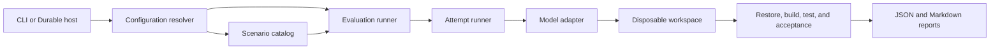

# Architecture and source guide

The repository separates CLI orchestration, reusable evaluation logic, benchmark data, and
documentation. Keep those boundaries intact: source files should remain the implementation record,
while these pages explain how readers navigate the system.

## Project boundaries

| Project or directory | Responsibility |
| --- | --- |
| `ModelEvaluator.Cli` | Parse commands, resolve configuration, invoke evaluation services, and print console summaries. |
| `ModelEvaluator.Core` | Load scenarios, run attempts, invoke adapters, validate generated projects, and write reports. |
| `ModelEvaluator.Durable` | Submit and execute the same core evaluation attempts through Durable Task Scheduler. |
| `benchmarks/` | Versioned project tasks, evaluator-owned acceptance tests, starter files, and reference samples. |
| `scenarios/` | Synthetic API/SDK comparison definitions. |
| `tests/` | Unit and integration-style tests for the harness. |
| `docs/` | Curated user, operator, benchmark-authoring, and developer documentation. |

Browse the
[`src` tree](https://github.com/sujithq/model-evaluator/tree/main/src) when implementation details
matter; use this page for the relationships between components.

## Project-generation flow

`EvaluationExecutionService` is the shared local execution boundary. It runs
`EvaluationRunner`, then persists JSON and Markdown reports through the report writers. The durable
host reuses the core runner at attempt granularity instead of duplicating grading logic.

Each project-generation attempt:

1. creates a fresh workspace from the scenario starter;
2. invokes the selected model adapter with the same resolved prompt;
3. validates the generated project structure;
4. restores and builds the generated solution;
5. runs supplied and generated tests;
6. runs evaluator-owned acceptance tests;
7. captures timing, usage, errors, and outcome evidence; and
8. appends the attempt to the run report.

## Core namespaces

The reusable implementation is organized by responsibility:

| Area | Purpose |
| --- | --- |
| `Configuration` | Load, resolve, and validate evaluation configuration and packaged presets. |
| `Scenarios` | Parse versioned benchmark packages and construct deterministic prompts. |
| `Adapters` | Translate a common model-attempt context into a CLI, API, SDK, or local fixture call. |
| `Evaluation` | Expand matrices, execute attempts, and apply scenario validation. |
| `Execution` | Run child processes and request parameter handling. |
| `Reporting` | Aggregate attempts and render Markdown and JSON output. |
| `Results` | Define report and attempt data contracts. |
| `Infrastructure` and `Util` | Shared metadata, hashing, argument, and file-system behavior. |

The API/SDK comparison subsystem currently lives alongside the benchmark harness in the same core
project under `ModelEvaluator.ApiComparison.Core` namespaces. It shares no benchmark grading
contract with the project-generation path.

## Extension points

### Add a model adapter

Implement `IModelAdapter` and register the adapter in the appropriate factory. The adapter receives
the scenario, normalized model configuration, workspace path, artifact path, prompt, and timeout.
It returns success, duration, runner, usage, and failure classifications without deciding the
grading result.

For command-line runners, prefer the existing `command-line` adapter and its placeholders before
writing a new C# adapter. See [Configuring model adapters](../model-adapters.md).

### Add a benchmark

Benchmark contracts are data, not C# feature flags. Add a versioned scenario package, validate it with
the CLI, and create both known-good and deliberately broken samples. Follow
[Adding a scenario](../adding-scenarios.md).

### Add report fields

Update the result contract, aggregation, both report writers, and focused tests together. JSON output
is a machine-readable contract; documentation alone is not sufficient to preserve compatibility.

## What belongs in documentation

| Content | Location |
| --- | --- |
| User workflows and commands | `docs/` |
| Benchmark rules and acceptance criteria | `benchmarks/` |
| Annotated runnable configuration | `config/` examples |
| Public/member API explanation | XML documentation comments in C# |
| Full API symbol browser | Add a DocFX build later if the public API becomes an independent consumer surface |
| Generated model or result data | Keep generated and link to it; do not hand-copy it into prose |

Generating one documentation page for every `.cs` file would create noise and duplicate the source.
The preferred current model is curated architecture pages plus direct repository links. If external
consumers begin using `ModelEvaluator.Core` as a library, DocFX can then be added as a generated API
reference without replacing MkDocs.
